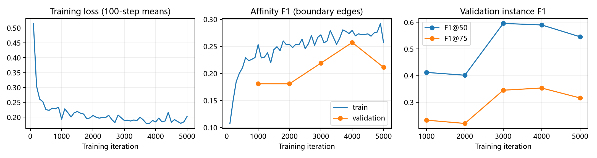
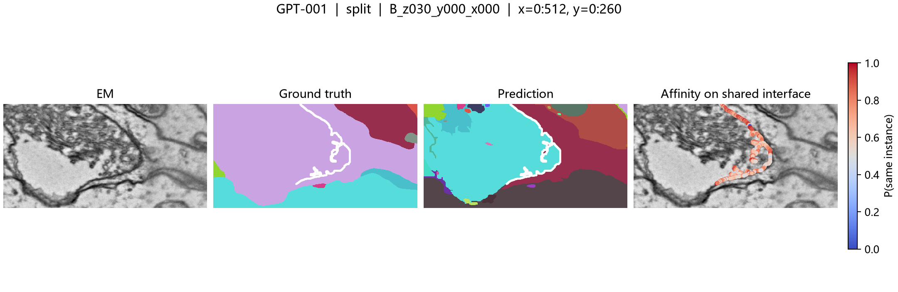
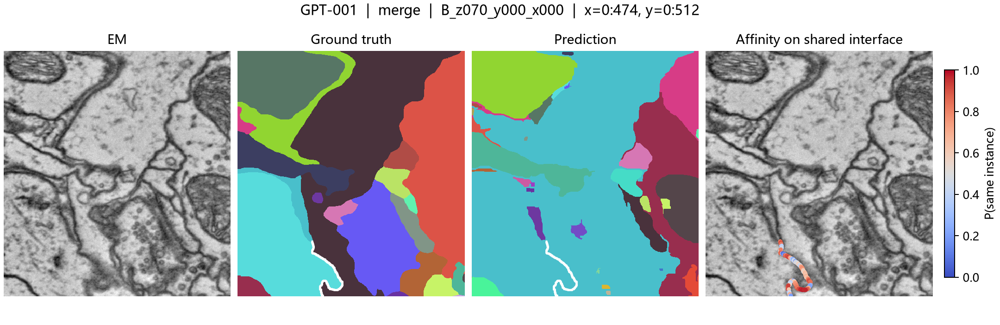

# 二维 EM 实例分割基线 · GPT 第 001 次分析

分析来源 **GPT**，更新编号 **GPT-001**，日期 **2026-11-27**。本次使用课程原始模型、损失、解码器和评估器。下次 GPT 分析续为 GPT-002；其他模型可以用自己的来源名和编号，并引用下面的固定案例 ID。对象 ID 仅在本图、本次预测内有效；跨模型比较请按图名、GT ID 和裁剪坐标定位。

## 复现与验证集结果

用训练集 A 的 96 张图进行 5,000 次更新。Small U-Net 有 121,978 个参数，基础通道数 8。每步随机取一个 128×128 图块，batch size 为 1，使用随机旋转和水平翻转，种子 2026。Adam 学习率 0.001，梯度范数上限 5，CPU 4 线程。训练步骤累计 128.94 秒，含周期性验证共 150.64 秒。

网络学习每个像素与右邻、下邻是否同属一个实例，交换对象编号不会改变训练目标。增强后重新生成两个方向的标签。类别平衡 BCE 给同实例边与边界边相同的总权重，并忽略无效边。解码时，取像素相邻边中最大的 1−p 形成边界图，平滑后（σ=0.6），用低于 0.35 且至少 16 像素的连通区作种子，分水岭从这些种子长出实例。

每 1,000 步在 B 上验证一次，按实例 F1@75 选检查点，同分时比较 F1@50。**第 4,000 步**入选。重新加载 best.pt，在 B 的全部 24 张 512×512 图像上复评。下表按整个划分汇总计数，分数范围为 0–1。

| 验证指标 | 精确率 | 召回率 | F1 |
|---|---:|---:|---:|
| 亲和度，边界边为正类 | 0.1514 | 0.8570 | 0.2573 |
| 实例，IoU ≥ 0.50 | 0.5269 | 0.6706 | 0.5901 |
| 实例，IoU ≥ 0.75 | 0.3157 | 0.4018 | 0.3535 |

共 1,023 个 GT 实例、1,302 个预测实例。IoU 门槛从 0.50 提高到 0.75，匹配数从 686 降到 411。边界召回率较高，但每 100 条被判为边界的边中只有约 15 条是真边界。该边级结果与最终实例误差的关系见下方案例。测试集 C 按任务书 §3.3 留到基线与改进方法均冻结后统一评估。



训练损失从首个 100 步窗口的 0.5152 降至末个窗口的 0.2027。验证 F1@50 在第 3,000 步最高（0.5957），F1@75 在第 4,000 步最高（0.3535），第 5,000 步回落至 0.3162。训练曲线每点汇总最近 100 个随机图块，验证曲线每点使用完整的 B。单次运行的五个验证点能说明检查点选择会影响结果，尚不足以确定末段回落的原因。

## 最差验证图像

按单图 F1@75 升序排列，同分依次按 F1@50、图名排序。下表列出末三张。分裂按受影响的 GT 对象计数，合并按受影响的预测对象计数。

| 图像 | 亲和度 F1 | F1@50 | F1@75 | GT / 预测数 | 分裂 / 合并候选 | 未匹配小目标 / 小目标 |
|---|---:|---:|---:|---:|---:|---:|
| B_z030_y000_x000 | 0.1643 | 0.3396 | 0.1887 | 15 / 38 | 2 / 0 | 0 / 0 |
| B_z070_y000_x000 | 0.2479 | 0.2373 | 0.2034 | 26 / 33 | 1 / 2 | 2 / 2 |
| B_z030_y738_x738 | 0.2382 | 0.5000 | 0.2500 | 29 / 35 | 3 / 0 | 2 / 2 |

为筛出可解释的分裂，要求一个 GT 与至少两个预测分别重叠至少 16 像素，各覆盖该 GT 至少 15%，且交集占相应预测至少 65%。合并交换 GT 和预测的角色。全验证集共筛出 **60 个分裂候选 GT** 和 **31 个合并候选预测**。这些计数依赖上述筛选条件，复杂的多对多重叠可能漏计。另以面积 ≤64 像素定义小目标，**45 个中全部**与任一预测的最大 IoU 都低于 0.50。小目标可能同时被合并，三类数量不能相加；面积阈值只用于诊断，官方指标保留所有尺寸。

## 两个可回查的失败案例

在末三张图的每类候选中，选取共享界面上亲和度误判边数最多的一对。计数仅含两个端点都落在选定区域的右向、下向边。图中白线标记被检查的共同界面；最后一列在同一位置显示网络给“属于同一实例”的概率，蓝低红高。界面统计使用评估器导出的 8 位亲和度 PNG，种子证据用冻结权重的浮点输出重建，并核对最终实例图逐像素相同。

### GPT-001-S01 · 同一神经元被切开

在 B_z030_y000_x000 中，GT 10 有 88,463 像素。预测 6 和 7 分别取走其中 53,068 和 24,453 像素，合计覆盖 87.6%。图中白线穿过同一个 GT 对象，预测沿这条线换了 ID。



两片间 786 条内部边中，只有 74 条（9.4%）被网络判作边界，平均同实例概率仍达 0.717。重建种子后，预测 6 和 7 的两个独立种子分别已有 44,729 和 21,677 个像素落在 GT 10 内。这说明分裂在种子阶段已经形成。分水岭会保留两个种子的 ID，即使最终分界线上的大部分单边都倾向于连接。单凭界面均值无法把分裂归因于某一条边。

### GPT-001-M01 · 两个神经元共用一个种子

在 B_z070_y000_x000 中，预测 2 吞入 GT 6 的 35,611 / 35,730 像素（99.7%）及 GT 23 的 63,941 / 64,820 像素（98.6%）。两个对象的真实接触面在预测图中失去了实例分界。



预测 2 内这两个 GT 的 275 条共享边中，186 条（67.6%）的同实例概率 ≥0.5，平均为 0.627，模型在真边界上倾向于把两侧相连。重建得到同一个连通种子 2，分别覆盖两块 GT 的 33,693 和 61,334 个像素。分水岭开始生长前，两侧已共享 ID。这个案例与分裂案例一起说明，最终错误还取决于亲和度图上低边界区域如何连通。

## 文件与复现

- [选定检查点](../../runs/baseline_5000/best.pt) 的 SHA-256 为 `414c0a7d18eeb5460747ebaf5b1d574a38621c4d6c1bd579f58204ddf17e5787`。
- [配置](../../runs/baseline_5000/config.json)、[训练日志](../../runs/baseline_5000.log)、[历史](../../runs/baseline_5000/history.json)、[耗时](../../runs/baseline_5000/summary.json)、[全量验证指标](../../runs/baseline_5000/val/metrics.json) 和 [原始预测](../../runs/baseline_5000/val/predictions/) 可供核查。
- [24 张验证图排名](validation_ranking.csv) 包含逐图指标和候选数。[案例记录](cases.json) 保存来源、更新编号、对象 ID、交集像素、种子像素和零起始裁剪坐标（右、下端点不含）。

本机使用 Python 3.12.16、PyTorch 2.14.1+cu130、NumPy 2.2.6、SciPy 1.15.3、Pillow 13.0.0 和 Matplotlib 3.11.2。从项目根目录运行以下 PowerShell 命令。训练和评估命令展示原始输出路径，复跑请在干净的项目副本中执行。仅重画曲线或重新提取案例可直接执行最后两行。

```powershell
$p = "$env:USERPROFILE/miniconda3/envs/pytorch"
$env:Path = "$p;$p/Library/bin;$env:Path"
$env:PYTHONPATH = "$env:LOCALAPPDATA/baseline-eval-deps"
& "$p/python.exe" baseline/train.py --out runs/baseline_5000
& "$p/python.exe" baseline/evaluate.py --checkpoint runs/baseline_5000/best.pt --split val --out runs/baseline_5000/val
& "$p/python.exe" baseline/visualize.py --history runs/baseline_5000/history.json --out analysis/GPT-001/learning_curves.png
& "$p/python.exe" analysis/GPT-001/analyze.py
```
