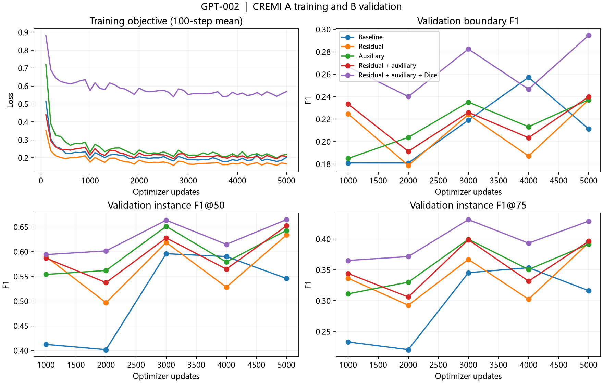

# 第一次网络更新 · GPT-002

来源 **GPT**，网络更新 **v1（第 1 次）**，分析记录 **GPT-002（第 2 次）**，2026-11-27。前次记录为 [GPT-001 基线诊断](../GPT-001/README.md)。

**选用残差 U-Net、辅助边界头和边界 Dice 损失的组合，第 3,000 步权重。** 在 B 的 24 张验证图上，实例 F1@75 从 0.3535 提升至 0.4314，21 张图的 F1@75 上升。IoU ≥0.75 的匹配由 411 增至 470 个，预测实例总数由 1,302 降至 1,156 个，GT 均为 1,023 个。[选定权重](../../runs/gpt_v1_dice/best.pt) · [逐图比较](per_image.csv)

## 哪些改动有效

- **残差卷积块。** 在编码器和解码器的双卷积块内加入捷径和组归一化。每步只用一个图块，组归一化直接使用当前样本的通道组统计量。本组把残差和归一化作为一个结构单元评估。
- **辅助边界头。** GPT-001 的两个案例都涉及跨像素的连通性。训练时，从四分之一分辨率的解码特征预测每个 4×4 区域是否包含有效的右向或下向真边界。最大池化保留细边界信号，全无有效边的区域跳过。辅助头增加 33 个训练参数，推理时只计算原来的两张全分辨率亲和度图。
- **边界 Dice 损失。** 在无 Dice 的联合版本上，边界召回率达到 0.9183，精确率只有 0.1289。因此补做一组仅改变训练损失的实验。在有效边上对边界概率 σ(−logit) 计算 soft Dice，使误报边界增加分母。入选版本的损失为全分辨率 balanced BCE + 0.3 × 辅助 balanced BCE + 0.5 × 边界 Dice 损失。

训练数据为 A 的 96 张图，验证数据为 B 的 24 张图。各组均从头训练 5,000 步，每步一个 128×128 图块；固定种子 2026、几何增强、基础通道数 8、Adam 学习率 0.001、梯度裁剪 5、CPU 4 线程和原分水岭参数。每 1,000 步用课程评估器验证，按 F1@75 选检查点及版本，同分再按 F1@50。复用了 GPT-001 基线，另外四个实验各有独立的预算、配置、训练日志和检查点，共新增 20,000 次优化更新。

| 训练版本 | 选中步数 | 参数量 | 训练时间（秒） | 亲和度 F1 | 实例 F1@50 | 实例 F1@75 |
|---|---:|---:|---:|---:|---:|---:|
| 原基线 | 4000 | 121,978 | 128.9 | 0.2573 | 0.5901 | 0.3535 |
| 残差块 + 组归一化 | 5000 | 129,058 | 182.3 | 0.2371 | 0.6335 | 0.3937 |
| 辅助边界头 | 3000 | 122,011 | 126.6 | 0.2352 | 0.6512 | 0.3996 |
| 残差块 + 辅助头 | 3000 | 129,091 | 160.7 | 0.2261 | 0.6277 | 0.3988 |
| 残差块 + 辅助头 + Dice | 3000 | 129,091 | 165.3 | 0.2825 | 0.6636 | 0.4314 |

单独加入残差块或辅助头都提高了实例 F1@75，但无 Dice 时，两项合用的分数与仅加辅助头相差 0.0008。在相同的残差和辅助头配置下，加入 Dice 后，边界精确率由 0.1289 升至 0.1682，召回率由 0.9183 降至 0.8808，实例 F1@75 由 0.3988 升至 0.4314。这个差值衡量的是 Dice 在该组合中的作用。各配置仅跑一个随机种子；验证集用于选择权重和配置，测试集 C 留待最终冻结后评估。

验证曲线的每个点均来自同一组 24 张图。左上图为各自训练目标的 100 步均值，含额外损失项的曲线只能用来观察各自的训练趋势。入选配置在第 5,000 步的 F1@50 达到 0.6648，但 F1@75 为 0.4290，低于第 3,000 步。

## 入选版本的精确率和召回率

| 验证指标 | 基线 P / R | 第一次更新 P / R | F1 绝对变化 |
|---|---|---|---:|
| 边界亲和度 | 0.1514 / 0.8570 | 0.1682 / 0.8808 | +0.0252 |
| 实例 @50 | 0.5269 / 0.6706 | 0.6254 / 0.7067 | +0.0735 |
| 实例 @75 | 0.3157 / 0.4018 | 0.4066 / 0.4594 | +0.0778 |

## 固定案例复查

沿用 GPT-001 的图名、GT、裁剪范围和全部界面边。最后的实例 ID 仅在单张预测内有效。图中金线是旧案例的界面，白线是被追踪 GT 的外轮廓。

**GPT-001-S01 · 分裂减轻，仍未完全恢复。** B_z030_y000_x000 的 GT 10 与最佳预测的 IoU 从 0.600 升到 0.691，仍未达到 0.75。在原先错误切开的 786 条内部边上，更新后分水岭仍切开 263 条。直接按 0.5 阈值计算的亲和度错误却从 74 条增至 97 条，可见局部分类与最终连通性评价会给出不同结果。该图整体 F1@75 从 0.1887 降至 0.1364，仍为验证集最低。[分裂对照图](split.png)

**GPT-001-M01 · 原合并仍然存在。** 在 B_z070_y000_x000 中，GT 6、23 在更新后仍有 99.6% 和 98.4% 的像素落入同一预测 6；原 275 条共同界面边仍全部被分水岭连在一起。界面上误判为同实例的亲和度边从 186 增至 192。两对象各自的最佳 IoU 从 0.248、0.443 升至 0.317、0.564，但模型仍未将它们分开。[合并对照图](merge.png)

**全验证集。** 按 GPT-001 同一重叠筛选标准，分裂候选从 60 个 GT 降至 45 个，合并候选从 31 个预测增至 34 个。在 45 个面积 ≤64 像素的小目标中，至少有一个预测达到 IoU 0.50 的对象从 0 个增至 3 个，仍有 42 个达不到。分裂、合并和小目标计数可能重叠，不能相加。

## 复现与核查

- [模型](../../baseline/model.py)、[损失](../../baseline/affinity.py)、[训练入口](../../baseline/train.py) 和 [检查点加载](../../baseline/engine.py) 支持新旧配置。旧权重仍可直接加载。
- [训练配置](../../runs/gpt_v1_dice/config.json)、[训练日志](../../runs/gpt_v1_dice.log)、[历史曲线数据](../../runs/gpt_v1_dice/history.json)、[官方评估结果](../../runs/gpt_v1_dice/val/metrics.json)、[全部版本数值与哈希](comparison.json)。选定 best.pt 的 SHA-256 为 `949230a444d392a1b341e517da3e7c6763799b336f39838e0e67fad18518f655`。
- 在含 GPT-001 基线结果的干净项目副本内执行 `./analysis/GPT-002/reproduce.ps1` 可复跑四个实验。运行环境与 GPT-001 一致。若已有各组验证输出，直接用同一 Python 环境执行 `python analysis/GPT-002/compare.py` 即可重画图表并复核数据。
- 本轮实际核查输出为 `PASS: 5 x 5000 updates, checkpoint reloads, full validation metrics, fixed interfaces`。每个版本均重新加载选中权重复评，逐图数值与训练时对应检查点一致。
