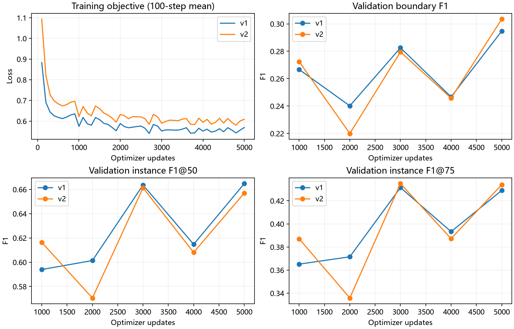

# GPT-003 · 第二次网络更新

来源 **GPT**，分析第 **003** 次，网络更新 **v2**，2026-11-27。对照为 [GPT-002 的入选版本 v1](../GPT-002/README.md)。

**按预定的验证集实例 F1@75 规则选中 v2 第 3,000 步权重。** 24 张图中有 12 张上升、12 张下降。全验证集汇总 F1@75 从 0.4314 升到 0.4349，约 +0.35 个百分点。合并候选由 34 个降到 28 个，但固定合并案例 M01 仍然失败。单一随机种子的这一微小差值尚不足以证明稳定优势。

## 可重复的对照

在训练集 A 从头运行一次 5,000 步训练。复用 v1 架构、初始化种子 2026、采样和几何增强、128×128 图块、batch size 1、Adam 学习率 0.001、CPU 4 线程，以及原损失和分水岭配置。每 1,000 步评估 B；先按 F1@75，再按 F1@50 选检查点。测试集 C 留到最终冻结后评估。

新增一个训练用 1×1 卷积头，从全分辨率解码特征给出四个 logit，依次为右 4、下 4、右 8、下 8 像素的亲和度。几何增强之后，直接比较两个端点的实例 ID；越界或任一端点为忽略标签 0 时屏蔽该位置。四个通道共同计算 balanced BCE，以预先指定的 0.3 倍权重加到 v1 损失上。推理仍走原来的两个最近邻通道。共有 129,127 个参数，比 v1 多 36 个。训练步骤累计 177.94 秒，含周期验证 203.25 秒；v1 分别为 165.32 和 191.77 秒。

| B 验证集（24 张，原始计数汇总） | v1 精确率 / 召回率 / F1 | v2 精确率 / 召回率 / F1 |
|---|---|---|
| 边界亲和度 | 0.1682 / 0.8808 / 0.2825 | 0.1657 / 0.8917 / 0.2795 |
| 实例 @50 | 0.6254 / 0.7067 / 0.6636 | 0.6118 / 0.7195 / 0.6613 |
| 实例 @75 | 0.4066 / 0.4594 / 0.4314 | 0.4023 / 0.4731 / 0.4349 |

在同样的 1,023 个 GT 上，预测数从 1,156 增至 1,203，IoU ≥0.75 的匹配从 470 增至 484。召回率升高，同时精确率有所下降。图中训练损失含各版本自己的辅助项；训练曲线可用于观察各自的收敛过程。



## 种子诊断与固定案例

用浮点亲和度按原解码器重建种子，核对两版所有 24 张图的分水岭结果与保存的实例 PNG 逐像素一致。候选筛选口径沿用 GPT-001。同一预测种子在至少两个候选 GT 内各有像素，即计为共享种子。v1 的 34 个合并候选全部满足，v2 的 28 个也全部满足；分裂候选两版均为 45 个。候选数属于重叠筛选统计，下降 6 个不等价于修复了 6 个指定对象。

- **GPT-001-M01，合并。** v1 的种子 6 在 GT 6 和 23 内分别有 33,737 和 61,552 像素。v2 的种子 6 仍跨越两者，分别有 33,810 和 61,424 像素。原 275 条固定接触边上，亲和度误判 192 → 194 条，解码后仍相连的边为 275 → 274 条。两个神经元的主要预测 ID 仍相同。[同位置对照](merge.png)
- **GPT-001-S01，分裂。** 原 786 条固定内部边中，解码后被切断的由 263 降至 191 条，但 GT 10 对最佳预测的整对象 IoU 从 0.691 降至 0.644。局部界面的改善没有转化为这个对象的整体改善。[同位置对照](split.png)
- **小目标。** 两版的面积 ≤64 像素 GT 均为 45 个，按官方 @50 一对一匹配都找回 3 个（6.7%）。其余 42 个也都没有任何预测达到 IoU 0.50。下面对每版各自漏掉的对象进行分类。

| 漏掉的小目标在分水岭生长前的状态 | v1 | v2 |
|---|---:|---:|
| GT 内无原始种子像素 | 27 | 27 |
| 有独立原始种子，但所有独立种子均小于 16 像素 | 8 | 8 |
| 仅与延伸到 GT 外的原始种子相交 | 4 | 5 |
| 已有达到 16 像素的独立种子 | 3 | 2 |

“独立”要求整块阈值连通区完全落在该 GT 内。一个 GT 同时包含独立和共享种子时，优先按独立种子分类。降低尺寸门槛可能直接保住第二行的种子，能否改善最终 IoU 仍需对照实验。逐候选记录包含图名、实例 ID 和种子像素数。[v1 种子明细](v1_seeds.json) · [v2 种子明细](v2_seeds.json)

## 文件与复现

[选定权重](../../runs/gpt_v2_long/best.pt) · [配置](../../runs/gpt_v2_long/config.json) · [日志](../../runs/gpt_v2_long.log) · [完整评估](../../runs/gpt_v2_long/val/metrics.json) · [逐图对照](per_image.csv) · [结构化比较与权重哈希](comparison.json)

沿用 GPT-002 的 Python 环境，在项目根目录运行。训练与评估入口要求新输出目录，原样复跑可使用含基线和 v1 记录的干净副本。

```powershell
$p = "$env:USERPROFILE/miniconda3/envs/pytorch"
$env:Path = "$p;$p/Library/bin;$env:Path"
$env:PYTHONPATH = "$env:LOCALAPPDATA/baseline-eval-deps"
$env:PYTHONUTF8 = "1"
& "$p/python.exe" analysis/GPT-003/seed_audit.py v1
& "$p/python.exe" baseline/train.py --architecture residual_unet --aux-weight 0.3 --dice-weight 0.5 --long-weight 0.3 --out runs/gpt_v2_long
& "$p/python.exe" baseline/evaluate.py --checkpoint runs/gpt_v2_long/best.pt --split val --out runs/gpt_v2_long/val
& "$p/python.exe" analysis/GPT-003/seed_audit.py v2
& "$p/python.exe" analysis/GPT-003/compare_v2.py
```

核查输出为 `PASS: matched configs, checkpoint reloads, 24 paired validation images and fixed interfaces`。种子图集按版本保存在本目录中，青色为候选对象的保留种子，真实接触面上红色代表亲和度预测同实例，黄色代表预测边界。
