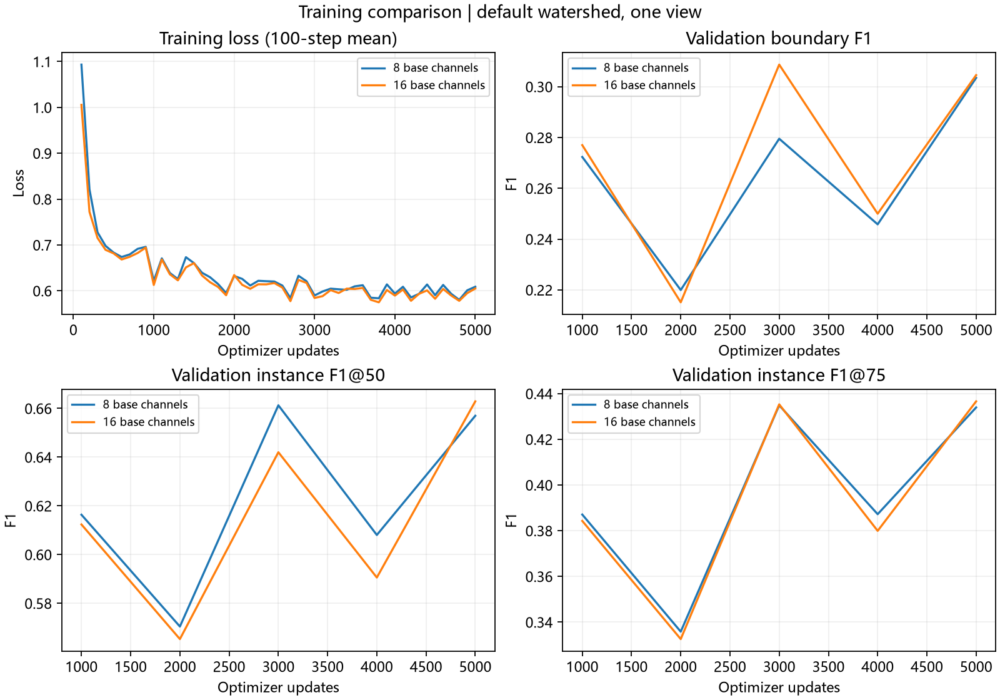

# GPT-004 · 第三次更新

来源 **GPT**，分析编号 **004**，版本 **v3**，2026-11-27。对照为 [v2](../GPT-003/README.md)。**验证集 B 的实例 F1@75 从 0.4349 升到 0.4583**，相对原基线 0.3535 提高 10.47 个百分点。24 张图中 18 张上升、1 张持平、5 张下降。

## 发布配置与取舍

默认版本采用 v2 第 3,000 步的权重、八视角平均和分水岭。八个视角由转置和水平、垂直翻转构成；每次预测先把右向和下向边的坐标、端点及通道恢复到原图，再平均同实例概率。低边界种子阈值从 0.35 调至 0.50，最小面积从 16 增至 32 像素，平滑 σ=0.6。最终配置随检查点保存，正常加载即可生效。

| 24 张图，按整个划分汇总 | v2 精确率 / 召回率 / F1 | v3 精确率 / 召回率 / F1 |
|---|---|---|
| 亲和度，边界边为正类 | 0.1657 / 0.8917 / 0.2795 | 0.1678 / 0.8921 / 0.2824 |
| 实例 @50 | 0.6118 / 0.7195 / 0.6613 | 0.6783 / 0.7048 / 0.6913 |
| 实例 @75 | 0.4023 / 0.4731 / 0.4349 | 0.4497 / 0.4673 / 0.4583 |

收益主要来自精确率。面对同样的 1,023 个 GT，预测数从 1,203 降至 1,063。@75 的 TP 从 484 降至 478，FP 从 719 降至 585。全量复评、解码及写出预测耗时约 21.8 秒，v2 约 5.5 秒（本机，CPU 4 线程）。

## 网络与推理消融

本轮从头训练了一个 16 基础通道的残差 U-Net，514,759 个参数。它沿用 v2 的训练集 A、5,000 次更新、batch size 1、128×128 裁剪、种子 2026、三项辅助损失设置及 Adam 学习率。训练步骤用时 288.2 秒，含周期验证 331.1 秒；v2 的 8 通道网络分别为 177.9 和 203.2 秒，有 129,127 个参数。训练期间每 1,000 步用原解码器验证，按 F1@75、再按 F1@50 选择每个网络的检查点。后续推理配置比较只使用这两个冻结的检查点。

| B 上的实例 F1@75 | 8 通道（v2 权重） | 16 通道（本轮训练） |
|---|---:|---:|
| 单视角，原解码 | 0.4349 | 0.4366 |
| 单视角，各网络选最佳解码 | 0.4532 | 0.4557 |
| 八视角，各网络选最佳解码 | **0.4583** | 0.4493 |

在 8 通道上，单独换用阈值 0.50、最小面积 32 得到 0.4532；在相同参数下加入八视角后升至 0.4583。原解码器下直接加入八视角为 0.4281。视角平均的效果依赖配套的种子设置。

首轮每组网络和视角数各比较 17 个配置，共 68 个。阈值为 0.20、0.35、0.50，最小面积为 8、16、32。在其中 4 组设置上额外检查了相邻分水岭区域的合并：至少接触 8 条边，平均亲和度达到 0.55 或 0.75 时连接，取图的连通分量。这种传递合并在 B 上产生大量欠分割，最佳 F1@75 也只有 0.0231。[全部配置与原始计数](validation_grid.csv)

固定这两个检查点后，另做了按 z 切片留一的选择敏感性检查。每次仅使用其余五个切片选择首轮配置，再汇总留出切片的预测计数，得到 F1@75 0.4470，对照 0.4349。六个切片中五个高于 v2。两个网络检查点本身都用过完整 B 选择，因此这项检查只能说明对配置选择的敏感程度。测试集 C 继续留待最终冻结后评估。[六折明细](slice_check.json)



## 针对合并的第二轮实验

主指标最高的配置使合并候选从 28 增至 41。为检查能否减少误合并，在该配置上另试 8 个组合：仅当一个宽松种子内部出现两个以上严格阈值的连通核心时，以核心替换大种子。严格阈值取 0.10 或 0.20，最小核心面积取 64 或 256；小种子补回策略分别关闭或要求至少 4 个高置信核心像素。这轮在观察首轮结果后开展，也仅使用 B。八组均未超过默认版的 F1@75。[第二轮逐组结果](marker_comparison.json)

| 验证结果 | v2 | v3 默认 | v3 减少合并配置 |
|---|---:|---:|---:|
| 实例 F1@75 | 0.4349 | **0.4583** | 0.4503 |
| 实例 F1@50 | 0.6613 | **0.6913** | 0.6758 |
| 严格匹配数 TP@75 | 484 | 478 | **507** |
| 合并候选 / 分裂候选 | 28 / 45 | 41 / 46 | **23** / 72 |
| 小目标中有预测达到 IoU 0.50（共 45） | 3 | 0 | 2 |

候选按 GPT-001 的相同重叠标准计数。减少合并的配置在 F1@75 高于 v2 且合并数不高于 v2 的候选中，先选小目标漏检最少、再选 F1@75 最高的组合。它和默认版共用权重，附加严格阈值 0.20、最小核心 256、补回核心 4。分裂候选增加说明它更容易把一个真实神经元切成多块。[可加载的解码配置](lower_merge_decoder.json)

## 复查固定对象

- **GPT-001-M01 · 合并仍存在。** 默认 v3 将两侧 GT 6 和 23 的主要像素都分给预测 5。种子 5 在两个 GT 内分别有 34,130、61,756 个像素。原接触面 275 条边全部被解码为相连，v2 为 274 条。减少合并配置也未将这两个 GT 分开。[同位置对照](merge.png)
- **GPT-001-S01 · 对象 IoU 略升，原界面仍有分裂。** 默认 v3 将 GT 10 的最佳 IoU 从 0.644 提至 0.661，但原 786 条内部边中被切断的从 191 增至 323 条。单看一条界面不足以判断整个对象的质量。[同位置对照](split.png)

## 获取与复现

[默认 v3 检查点](../../runs/gpt_v3_final/best.pt) · [完整配置](../../runs/gpt_v3_final/config.json) · [全量验证指标](../../runs/gpt_v3_final/val/metrics.json) · [逐图差值](per_image.csv) · [案例数据与权重哈希](comparison.json) · [加宽网络训练日志](../../runs/gpt_v3_wide.log)

在含 v2 结果的干净项目副本中执行 [reproduce.ps1](reproduce.ps1) 可依次复跑训练、两轮解码选择和最终复查。使用同一 Python 环境时，可通过以下命令单独复评减少合并的配置（输出目录需为空）。

```powershell
python baseline/evaluate.py --checkpoint runs/gpt_v3_final/best.pt --split val --decoder-config analysis/GPT-004/lower_merge_decoder.json --out runs/gpt_v3_lower_merge_eval
```

实际核查输出为 `PASS: released checkpoint, 24 official per-image records, matched diagnostics and original cases`。重新加载发布权重后的逐图指标和选中配置一致。
